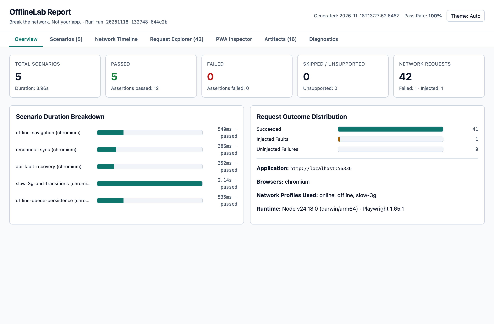
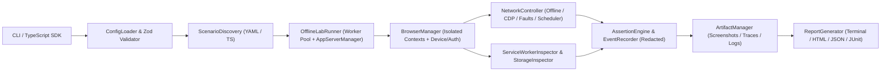
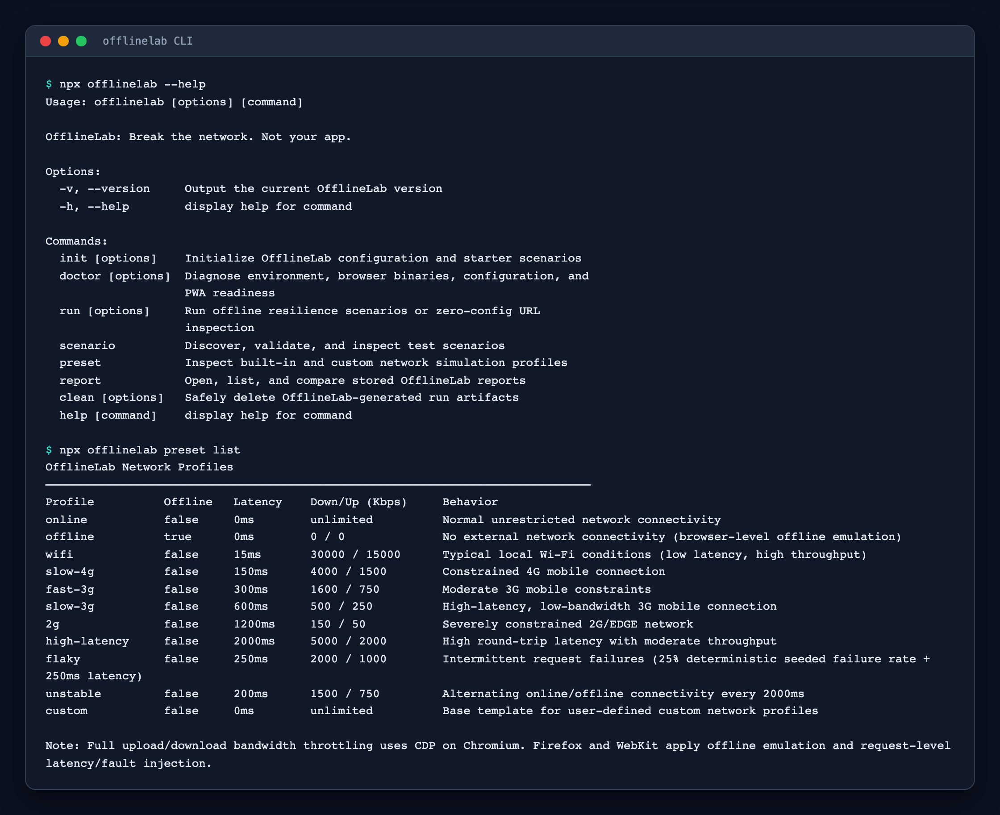
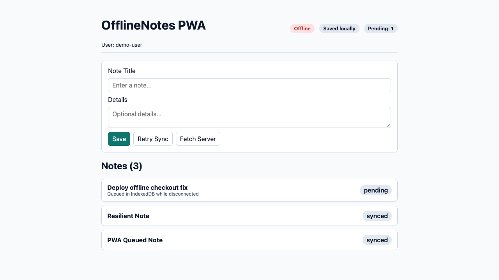
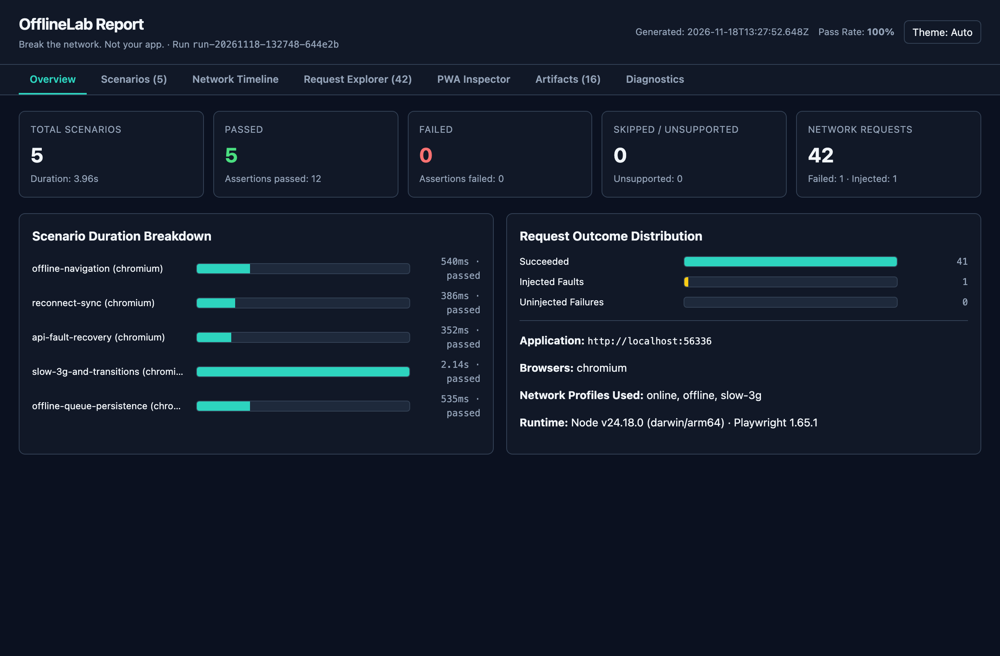
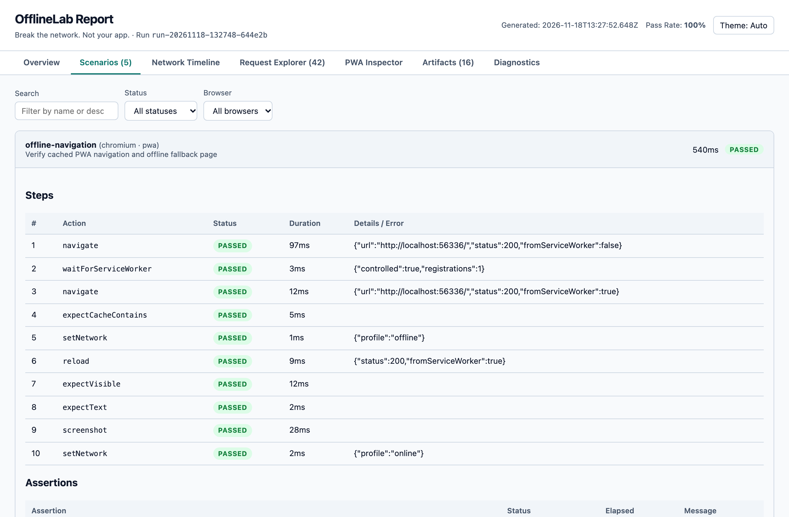
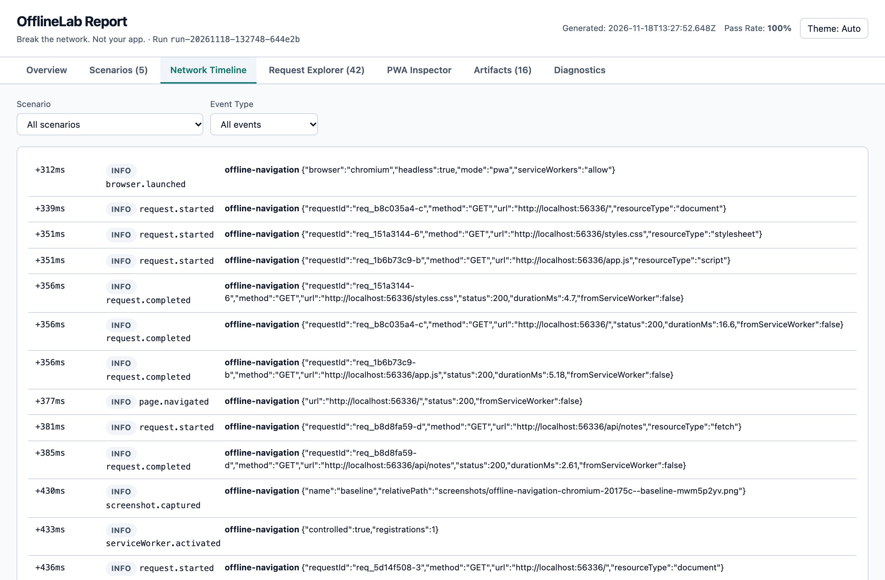
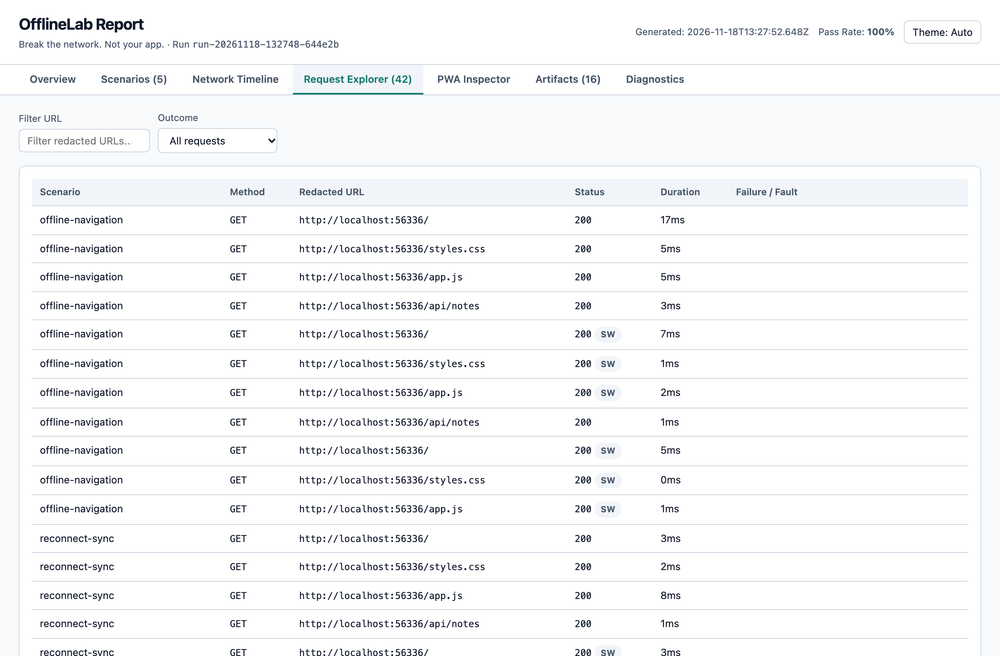
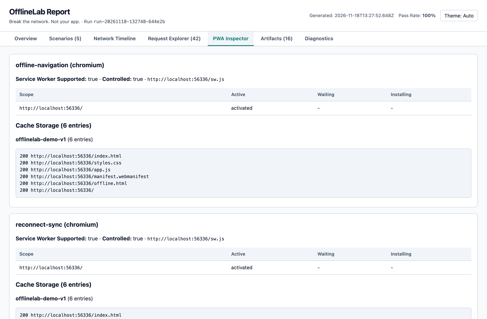

# OfflineLab

**Break the network. Not your app.**

[](https://github.com/PiushKS/offlinelab/actions/workflows/ci.yml)
[](https://github.com/PiushKS/offlinelab/actions/workflows/compatibility.yml)
[](./LICENSE)

**OfflineLab** is a local-first, privacy-first, deterministic open-source CLI and TypeScript testing framework built on [Playwright](https://playwright.dev/) for verifying how web applications and Progressive Web Apps (PWAs) behave under real network disruptions: complete disconnection, slow connections, high latency, intermittent request loss, API faults, offline persistence, cache fallbacks, and reconnection synchronization.



---

## Table of Contents

- [Why OfflineLab?](#why-offlinelab)
- [System Architecture & How It Works](#system-architecture--how-it-works)
- [1. Installation & Environment Check](#1-installation--environment-check)
- [2. Three Ways to Use OfflineLab](#2-three-ways-to-use-offlinelab)
- [3. Mode A: Zero-Config CLI Inspection](#3-mode-a-zero-config-cli-inspection)
- [4. Mode B: Project Setup & Full Configuration Reference](#4-mode-b-project-setup--full-configuration-reference)
- [5. YAML Scenarios: Complete Action & Template Reference](#5-yaml-scenarios-complete-action--template-reference)
- [6. TypeScript Scenarios (`defineScenario`)](#6-typescript-scenarios-definescenario)
- [7. Network Simulation Engine & Fault Injection](#7-network-simulation-engine--fault-injection)
- [8. PWA, Service Worker, Cache Storage & Sync Testing](#8-pwa-service-worker-cache-storage--sync-testing)
- [9. Reports, Timeline, Artifacts & Run Comparison](#9-reports-timeline-artifacts--run-comparison)
- [10. Mode C: Programmatic TypeScript SDK Reference](#10-mode-c-programmatic-typescript-sdk-reference)
- [11. Plugin & Extension Architecture](#11-plugin--extension-architecture)
- [12. Mobile Emulation, Authentication & Local Dev Server](#12-mobile-emulation-authentication--local-dev-server)
- [13. Complete CLI Reference](#13-complete-cli-reference)
- [14. CI / GitHub Actions Integration & Exit Codes](#14-ci--github-actions-integration--exit-codes)
- [15. Included Offline-First Demo PWA & Examples](#15-included-offline-first-demo-pwa--examples)
- [16. Browser Capability Matrix & Simulation Limitations](#16-browser-capability-matrix--simulation-limitations)
- [17. Security & Privacy Design](#17-security--privacy-design)
- [18. Troubleshooting](#18-troubleshooting)
- [19. Development, Contributing & License](#19-development-contributing--license)

---

## Why OfflineLab?

Web applications and PWAs are usually tested on fast, stable localhost connections. In production, users encounter elevators, tunnels, spotty cellular handoffs, captive portals, rate-limited APIs, and dropped responses. Common production bugs that escape ordinary unit and E2E suites include:

- **Uncached or uncontrolled app shells:** A Service Worker registers on the first visit, but does not control the page yet when the user reloads offline.
- **Silent data loss on reload:** Forms accept input while offline, display optimistic UI, and wipe user data if the tab refreshes before reconnecting.
- **Duplicate submissions on retry:** The backend persists a `POST` request, the response drops mid-stream, and the client retries without idempotency protection.
- **Broken error states:** HTTP 500, 503, 429, or malformed JSON responses leave spinners stuck forever or throw uncaught exceptions.
- **Connectivity race conditions:** Rapid `online -> slow-3g -> offline -> online` transitions trigger stale overwrites or unhandled promise rejections.

OfflineLab tests these behaviors deterministically using real browsers, isolated browser contexts, seeded fault rules, explicit capability detection, and verifiable assertions.

### Design Principles

- **Local-first and offline-capable:** Runs completely locally after dependencies and browsers are installed. No mandatory cloud account, no paid API, no hidden telemetry.
- **Deterministic by default:** Seeded PRNG fault schedules, monotonic elapsed timing, explicit rule precedence, and isolated browser contexts per scenario.
- **Honest capability reporting:** Never pretends a page is "offline-ready" merely because it loaded, and never silently fakes Chromium CDP bandwidth throttling on Firefox or WebKit.
- **Privacy by default:** Automatically redacts URL credentials, query parameters, cookies, authorization headers, JWTs, and common secrets before writing logs or reports.

---

## System Architecture & How It Works



### Core Internal Modules

| Module | Source Path | Responsibility |
|---|---|---|
| `ConfigLoader` & `ConfigValidator` | `src/config/` | Auto-discovers `.ts`/`.js`/`.yaml`/`.json` configs, strips prototype-pollution keys, validates with strict Zod schemas. |
| `ScenarioDiscovery` | `src/core/scenarios/discovery.ts` | Discovers and validates YAML and TypeScript scenarios with `fast-glob` and `jiti`. |
| `OfflineLabRunner` | `src/core/runner/runner.ts` | Orchestrates plugins, `AppServerManager`, parallel worker pool, Mode A zero-config inspection, and report generation. |
| `ScenarioExecutor` | `src/core/scenarios/executor.ts` | Runs one scenario with pre-flight capability checks, isolated context, retries, timeouts, artifact capture, and evidence-based diagnostics. |
| `BrowserManager` & `BrowserAdapter` | `src/browser/` | Manages reusable Playwright browsers, isolated contexts, device descriptors, auth state, and the Chromium/Firefox/WebKit capability matrix + CDP throttling adapter. |
| `NetworkController` | `src/network/controller/network-controller.ts` | Coordinates `context.setOffline`, CDP bandwidth/latency emulation, Playwright route interception, unstable toggling, and request/console observers. |
| `NetworkProfileRegistry` | `src/network/profiles/registry.ts` | Stores the 11 built-in profiles and validates user-defined custom profiles. |
| `FaultInjectionEngine` | `src/network/faults/fault-engine.ts` | Evaluates URL glob/regex patterns, HTTP methods, resource types, count/duration/phase filters, rule precedence, and Mulberry32 seeded probabilities. |
| `NetworkScheduler` | `src/core/scheduler/network-scheduler.ts` | Monotonic timed network transition engine with `AbortSignal` cancellation and zero timer leakage. |
| `ServiceWorkerInspector` & `StorageInspector` | `src/browser/service-workers/`, `src/browser/storage/` | Real browser-API inspection for Service Worker registrations/controllers, Cache Storage, `localStorage`, `sessionStorage`, and `IndexedDB`. |
| `AssertionEngine` | `src/core/assertions/assertion-engine.ts` | Executes YAML step assertions and provides the typed `expect()` API for TypeScript scenarios. |
| `EventRecorder` | `src/core/events/event-recorder.ts` | Bounded, monotonic-clock event, request, and console recording with automatic redaction. |
| `ArtifactManager` & `ReportGenerator` | `src/artifacts/`, `src/reporters/` | Manages safe artifact paths, screenshots, Playwright traces, cleanup, and Terminal/HTML/JSON/JUnit output. |
| `Redactor` & Path Safety | `src/security/` | Redacts secrets, escapes HTML/XML/JSON, and enforces strict directory containment. |
| `PluginManager` | `src/plugins/plugin-manager.ts` | Loads explicitly configured plugins for custom assertions, profiles, reporters, and event listeners. |

---

## 1. Installation & Environment Check

### Requirements

- **Node.js 22 or newer** (ESM runtime)
- **macOS, Linux, or Windows**

### Install the Package

```bash
# npm
npm install -D offlinelab

# pnpm
pnpm add -D offlinelab

# yarn
yarn add -D offlinelab
```

### Install Playwright Browsers

OfflineLab never silently downloads browser binaries during ordinary CLI execution. Install the browser(s) you plan to run:

```bash
# Recommended default (supports offline mode, CDP bandwidth throttling, full PWA/SW inspection)
npx playwright install chromium

# Optional: cross-browser testing
npx playwright install chromium firefox webkit

# Linux CI environments (installs OS libraries too)
npx playwright install --with-deps chromium
```

### Run Environment Diagnostics (`doctor`)

Verify your local setup before writing or running tests:

```bash
npx offlinelab doctor
npx offlinelab doctor --json
```

`doctor` checks:
1. Node.js version (`>=22.0.0`)
2. Operating system and architecture
3. Installed Playwright version
4. Configuration validity (if an `offlinelab.config.*` file exists)
5. Browser binary availability for every configured browser
6. Real headless browser launch and clean close (disable with `--skip-launch-check`)
7. Browser capability notes (e.g. CDP throttling limitations on Firefox/WebKit)
8. Scenario file discovery and schema validation
9. Report directory write permissions
10. Target `baseURL` reachability (if configured)
11. Potentially incompatible Service Worker / secure-context settings



---

## 2. Three Ways to Use OfflineLab

All three workflows share the same underlying execution engine, network controller, redaction pipeline, and reporting format.

| Mode | Entry Point | Best For |
|---|---|---|
| **Mode A: Zero-config CLI inspection** | `npx offlinelab run --url http://localhost:3000` | Fast smoke-checks on any running local app without writing config or scenarios. |
| **Mode B: Config + YAML/TS scenarios** | `npx offlinelab init` then `npx offlinelab run` | Version-controlled offline resilience test suites in local dev and CI. |
| **Mode C: Programmatic TypeScript SDK** | `import { OfflineLab } from "offlinelab"` | Embedding network disruption and PWA assertions into Vitest, Jest, or custom Node.js scripts. |

---

## 3. Mode A: Zero-Config CLI Inspection

Point OfflineLab at any locally running app:

```bash
npx offlinelab run --url http://localhost:3000
```

### Step-by-Step Execution Flow

1. Launches an isolated headless Chromium context.
2. Navigates to the URL online and checks for a valid HTTP response.
3. Captures `baseline-online` screenshot.
4. Inspects `navigator.serviceWorker` registrations, active/controller state, and Cache Storage entries.
5. Switches the browser context offline (`context.setOffline(true)`).
6. Attempts a safe offline reload probe (`timeout: 10000ms`), recording whether the page rendered offline or failed with a network error.
7. Captures `offline-probe` screenshot if rendered.
8. Restores online connectivity (`context.setOffline(false)`) and verifies the page loads again (`restored-online` screenshot).
9. Records all network requests, console errors, and monotonic timeline events.
10. Generates standalone HTML, JSON, and JUnit reports in `./offlinelab-results/`.

### Honest Scope Guarantee

Zero-config inspection **never** reports full offline-readiness merely because a page opened. Its report notes explicitly separate:
- **Verified:** online HTTP load, Service Worker registration/controller state, Cache Storage entry count, offline reload probe outcome, and online restoration.
- **Not verified:** application-specific offline UI states, offline form submissions, IndexedDB queue integrity, reconnection synchronization, conflict resolution, and API fault recovery.

---

## 4. Mode B: Project Setup & Full Configuration Reference

### Initialize a Project

```bash
# Interactive wizard (detects package manager and prompts for template & baseURL)
npx offlinelab init

# Non-interactive initialization
npx offlinelab init --yes --template web --url http://localhost:3000
npx offlinelab init --yes --template pwa --url http://localhost:4173
npx offlinelab init --yes --template api --url http://localhost:3000

# Overwrite existing config/scenario files explicitly
npx offlinelab init --yes --template pwa --force
```

Templates generated by `init`:
- `web`: `offlinelab.config.ts` (`mode: "auto"`) + `scenarios/offline-resilience.yaml` + `scenarios/slow-network.yaml`
- `pwa`: `offlinelab.config.ts` (`mode: "pwa"`, `serviceWorkers: "allow"`) + `scenarios/offline-navigation.yaml` + `scenarios/reconnect-sync.yaml`
- `api`: `offlinelab.config.ts` (`mode: "interception"`, `serviceWorkers: "block"`) + `scenarios/api-500-resilience.yaml` + `scenarios/api-slow-latency.yaml`

### Configuration File Discovery Order

OfflineLab automatically checks for the first matching file in your working directory (or pass `--config <path>`):
1. `offlinelab.config.ts`
2. `offlinelab.config.mts`
3. `offlinelab.config.js`
4. `offlinelab.config.mjs`
5. `offlinelab.config.yaml`
6. `offlinelab.config.yml`
7. `offlinelab.config.json`

### Complete Annotated `offlinelab.config.ts`

```ts
import { defineConfig } from "offlinelab";

export default defineConfig({
  // Base URL resolved against relative scenario paths (e.g. path: "/dashboard")
  baseURL: "http://localhost:4173",

  // Target Playwright browsers: "chromium" | "firefox" | "webkit"
  browsers: ["chromium"],

  // Glob patterns for YAML and TypeScript/JS scenarios
  scenarios: ["scenarios/**/*.yaml", "scenarios/**/*.ts"],

  // Execution mode: "auto" | "pwa" | "interception"
  mode: "auto",

  // Service Worker context policy: "allow" | "block"
  // Note: mode "pwa" with serviceWorkers "block" fails validation
  serviceWorkers: "allow",

  // Parallel isolated browser contexts (1..32)
  workers: 2,

  // Retries on failed scenarios (0..10)
  retries: 0,

  // Default timeout in milliseconds
  timeoutMs: 30_000,

  // Fine-grained timeout overrides
  timeouts: {
    browserLaunchMs: 30_000,
    navigationMs: 20_000,
    stepMs: 15_000,
    assertionMs: 10_000,
    scenarioMs: 60_000,
    runMs: 300_000,
  },

  // Run headless by default (override via --headed)
  headless: true,

  // Optional Playwright mobile device preset or custom device config
  // device: "iPhone 15",

  // Custom reusable network profiles
  networkProfiles: {
    "custom-mobile": {
      name: "custom-mobile",
      description: "Constrained rural mobile profile",
      offline: false,
      latencyMs: 800,
      downloadKbps: 250,
      uploadKbps: 100,
      failureRate: 0.15, // Fraction 0..1 (15%)
      seed: 42,
    },
  },

  // Policy when a browser lacks a required capability: "skip" | "fail" | "warn"
  unsupportedPolicy: "skip",

  // Reporting configuration
  reports: {
    directory: "./offlinelab-results",
    formats: ["html", "json", "junit"],
    retentionDays: 30,
    maxRuns: 50,
  },

  // Screenshot, Playwright trace, and bounded event recording
  artifacts: {
    screenshots: "on-failure", // "on-failure" | "always" | "never"
    traces: "on-failure", // "on-failure" | "always" | "never"
    baselineScreenshot: true,
    captureBeforeAfter: false,
    maxNetworkEvents: 1000,
    includeBodies: false,
  },

  // Security & privacy redaction rules
  redaction: {
    redactQueryParams: true,
    allowedQueryParams: ["page", "tab"],
    redactHeaders: ["x-internal-token"],
    secretPatterns: ["my_custom_prefix_[A-Za-z0-9]{10,}"],
  },

  // Optional managed local dev server
  webServer: {
    command: "npm run dev",
    url: "http://127.0.0.1:4173",
    cwd: ".",
    timeoutMs: 30_000,
    reuseExistingServer: true,
    env: { NODE_ENV: "test" },
    gracefulShutdownMs: 3000,
  },

  // Optional authentication & browser state
  // auth: {
  //   storageState: "./playwright/.auth/user.json",
  // },

  // Optional explicitly trusted local plugins
  plugins: [],
});
```

### Configuration Property Reference

| Property | Type | Default | Constraints & Notes |
|---|---|---|---|
| `baseURL` | `string` | `undefined` | Must be a valid `http://` or `https://` URL. |
| `browsers` | `BrowserName[]` | `["chromium"]` | Non-empty array of `"chromium"`, `"firefox"`, `"webkit"`. |
| `scenarios` | `string[]` | `["scenarios/**/*.{yaml,yml,ts,mjs,js}"]` | Fast-glob patterns relative to `cwd`. |
| `mode` | `"pwa" \| "interception" \| "auto"` | `"auto"` | Enforces PWA vs interception contract validation. |
| `serviceWorkers` | `"allow" \| "block"` | `"allow"` | Cannot be `"block"` when `mode: "pwa"`. |
| `workers` | `number` | `1` | Integer `1..32`. Each worker uses an isolated browser context. |
| `retries` | `number` | `0` | Integer `0..10`. Retries failed scenarios only. |
| `timeoutMs` | `number` | `30000` | Integer `1000..600000`. |
| `timeouts` | `TimeoutsConfig` | `{ browserLaunchMs: 30000, navigationMs: 20000, stepMs: 15000, assertionMs: 10000, scenarioMs: 60000 }` | Optional `runMs` caps total run duration (`1000..3600000`). |
| `headless` | `boolean` | `true` | Overridden by `--headed` or `--ci`. |
| `device` | `string \| DeviceConfig` | `undefined` | Any Playwright `devices` descriptor name or custom viewport/DPR/touch/orientation object. |
| `networkProfiles` | `Record<string, Partial<NetworkProfileConfig>>` | `undefined` | Merged into `NetworkProfileRegistry`. |
| `unsupportedPolicy` | `"skip" \| "fail" \| "warn"` | `"skip"` | `"fail"` causes nonzero exit code (`1`) on unsupported capabilities. |
| `reports.directory` | `string` | `"./offlinelab-results"` | Dedicated directory for runs and latest reports. |
| `reports.formats` | `ReportFormat[]` | `["html", "json", "junit"]` | Any combination of `"html"`, `"json"`, `"junit"`, `"terminal"`. |
| `artifacts.screenshots` | `"on-failure" \| "always" \| "never"` | `"on-failure"` | Explicit `screenshot` steps always capture regardless. |
| `artifacts.traces` | `"on-failure" \| "always" \| "never"` | `"on-failure"` | Saves Playwright `.zip` trace files viewable with `npx playwright show-trace`. |
| `artifacts.maxNetworkEvents` | `number` | `1000` | Bounds recorded requests in memory (`10..50000`). |
| `redaction` | `RedactionConfig` | Query params & sensitive headers redacted | Controls URL query param redaction, header redaction, regexes, and custom replacer. |
| `webServer` | `WebServerConfig` | `undefined` | Starts configured server before scenarios and cleans up child process trees on exit. |
| `auth` | `AuthConfig` | `undefined` | Supports `storageState`, `persistentProfileDir`, `setup(context, page)`, and `teardown(context)`. |
| `plugins` | `OfflineLabPlugin[]` | `undefined` | Explicitly imported plugins only. |

---

## 5. YAML Scenarios: Complete Action & Template Reference

YAML scenarios are parsed in **strict mode** (duplicate keys rejected, no embedded JS evaluation, prototype-pollution keys stripped) and validated against `YamlScenarioSchema` before any browser launches.

### Top-Level YAML Scenario Fields

```yaml
name: offline-navigation              # Required unique scenario name (1..128 chars)
description: Verify cached PWA shell  # Optional human-readable description
mode: pwa                             # Optional: "pwa" | "interception" | "auto"
browser: chromium                     # Optional single browser override
browsers: [chromium, firefox]         # Optional multi-browser override
tags: [pwa, critical]                 # Optional tags for --pattern filtering
timeoutMs: 45000                      # Optional scenario timeout override
retries: 1                            # Optional retry override
serviceWorkers: allow                 # Optional: "allow" | "block"
device: "iPhone 15"                   # Optional Playwright device or custom DeviceConfig
baseURL: "http://localhost:4173"      # Optional baseURL override
storageState: "./auth.json"           # Optional Playwright storageState file
requires:                             # Optional capability requirements
  cdpThrottling: false
  serviceWorkers: true
  requestInterception: false
steps:                                # Required non-empty array of steps
  - action: navigate
    path: /
```

### Complete YAML Action Reference

#### Navigation & UI Interaction Actions

| Action | Parameters | Behavior |
|---|---|---|
| `navigate` | `path?`, `url?`, `waitUntil?` (`load`\|`domcontentloaded`\|`networkidle`\|`commit`), `timeoutMs?`, `expectFailure?` | Navigates to URL or `baseURL + path`. When `expectFailure: true`, succeeds only if navigation fails (used for cold-cache offline checks). |
| `reload` | `waitUntil?`, `timeoutMs?`, `expectFailure?` | Reloads the current page and records whether the response came from a Service Worker. |
| `click` | `selector`, `timeoutMs?` | Clicks the first element matching `selector`. |
| `fill` | `selector`, `value`, `timeoutMs?` | Fills an input or textarea matching `selector`. |
| `press` | `key`, `selector?`, `timeoutMs?` | Presses a keyboard key on `selector` or the page keyboard. |
| `select` | `selector`, `value` (`string \| string[]`), `timeoutMs?` | Selects option(s) in a `<select>` element. |
| `waitForSelector` | `selector`, `state?` (`attached`\|`detached`\|`visible`\|`hidden`), `timeoutMs?` | Waits until `selector` reaches the requested DOM state. |
| `waitForURL` | `url` (glob/regex/substring), `timeoutMs?` | Waits until `page.url()` matches `url`. |
| `waitForResponse` | `url`, `status?`, `timeoutMs?` | Waits for a matching HTTP response. |
| `waitForRequest` | `url`, `method?`, `timeoutMs?` | Waits for a matching outgoing HTTP request. |
| `wait` | `durationMs` (`1..60000`), `reason?` | Explicit bounded wait (for timed network outage windows or schedules; avoid using for ordinary element readiness). |

#### Network Control Actions

| Action | Parameters | Behavior |
|---|---|---|
| `setNetwork` | `profile`, `custom?`, `requireBandwidthThrottling?` | Applies a built-in or custom network profile. Throws `UnsupportedCapabilityError` on non-Chromium browsers when `requireBandwidthThrottling: true`. |
| `setOffline` | none | Switches the browser context offline (`context.setOffline(true)`). |
| `setOnline` | none | Restores online connectivity and resets active CDP throttling. |
| `injectFailure` | `url`, `fault`, `id?`, `methods?`, `resourceTypes?`, `statusCode?`, `body?`, `headers?`, `contentType?`, `delayMs?`, `probability?`, `seed?`, `once?`, `firstN?`, `everyNth?`, `durationMs?`, `phase?`, `priority?` | Registers a targeted request fault rule in `FaultInjectionEngine`. |
| `removeFailure` | `id?`, `all?` | Removes one rule by `id` or clears all active fault rules (`all: true`). |
| `delayRequests` | `url`, `delayMs`, `id?`, `methods?`, `resourceTypes?`, `probability?`, `seed?`, `once?`, `firstN?` | Adds a request-level delay before forwarding matching requests. |
| `mockResponse` | `url`, `status?` (default `200`), `body?`, `json?`, `headers?`, `contentType?`, `methods?`, `delayMs?`, `once?`, `id?` | Fulfills matching requests with a deterministic mock response. |
| `startNetworkSchedule` | `steps: [{ atMs, profile, label? }]`, `repeat?` | Starts a monotonic timed network transition schedule. |
| `stopNetworkSchedule` | none | Cancels any running network schedule immediately. |

#### PWA & Storage Inspection Actions

| Action | Parameters | Behavior |
|---|---|---|
| `waitForServiceWorker` | `controlled?`, `state?` (`installing`\|`installed`\|`activating`\|`activated`), `timeoutMs?` | Waits for a real Service Worker registration to reach `state` and optionally control `navigator.serviceWorker.controller`. |
| `inspectCache` | none | Snapshots all Cache Storage caches, entry counts, and redacted URLs into the report. |
| `inspectIndexedDB` | `databases?`, `stores?`, `includeValues?`, `maxRecords?` | Snapshots IndexedDB databases, stores, record counts, and optional redacted values. |
| `inspectLocalStorage` | `allowedKeys?`, `includeValues?` | Snapshots `localStorage` with automatic secret-key redaction. |
| `captureStorageSnapshot` | `name?`, `includeLocalStorage?`, `includeSessionStorage?`, `includeIndexedDB?`, `includeCacheStorage?`, `includeValues?`, `allowedKeys?` | Captures a combined privacy-safe snapshot of browser storage before or after connectivity changes. |

#### Assertion Actions

| Action | Parameters | Behavior |
|---|---|---|
| `expectVisible` | `selector`, `timeoutMs?` | Asserts the element is visible within timeout. |
| `expectHidden` | `selector`, `timeoutMs?` | Asserts the element is hidden or detached within timeout. |
| `expectText` | `selector`, `text`, `exact?`, `timeoutMs?` | Asserts the element's trimmed text contains (or equals when `exact: true`) `text`. |
| `expectURL` | `url`, `exact?`, `timeoutMs?` | Asserts the current page URL matches `url`. |
| `expectRequestCount` | `url`, `count?`, `min?`, `max?`, `method?` | Asserts the number of recorded requests matching `url` (and optional `method`). |
| `expectResponseStatus` | `url`, `status`, `method?` | Asserts at least one matching request received HTTP `status`. |
| `expectNoConsoleErrors` | `ignorePatterns?` | Asserts zero browser `console.error` / `pageerror` entries (excluding matching regexes). |
| `expectStorageValue` | `storage` (`localStorage`\|`sessionStorage`), `key`, `value?`, `exists?` | Asserts existence, absence (`exists: false`), or exact string value of a storage key. |
| `expectCacheContains` | `urlPattern`, `cacheName?` | Asserts Cache Storage contains at least one entry matching `urlPattern`. |
| `expectIndexedDBRecord` | `database`, `store`, `count?`, `minCount?`, `match?`, `timeoutMs?` | Polls IndexedDB until matching record count satisfies `count` / `minCount` / field `match`. |
| `customAssertion` | `name`, `options?` | Executes a custom assertion registered by a configured plugin. |

#### Artifact & Timeline Actions

| Action | Parameters | Behavior |
|---|---|---|
| `screenshot` | `name`, `fullPage?` | Captures a PNG screenshot into the run's `screenshots/` directory and attaches it to the HTML report. |
| `snapshot` | `name?` | Captures a point-in-time SW, Cache Storage, URL, and connectivity marker on the timeline. |
| `markTimelineEvent` | `label`, `details?` | Adds a custom annotated event marker to the Network Timeline. |

### Full Real-World YAML Example: Offline Mutation Queue & Reconnect Sync

```yaml
name: reconnect-sync
description: Verify offline note creation persists across reload and syncs after reconnecting
mode: pwa
browser: chromium

steps:
  - action: navigate
    path: /

  - action: waitForServiceWorker
    controlled: true
    timeoutMs: 15000

  - action: navigate
    path: /

  - action: setOffline

  - action: fill
    selector: "[data-testid='note-title-input']"
    value: "Deploy offline checkout fix"

  - action: click
    selector: "[data-testid='save-note-btn']"

  - action: expectText
    selector: "[data-testid='pending-count']"
    text: "1"

  - action: expectIndexedDBRecord
    database: offlinelab-demo-db
    store: notes
    minCount: 1
    match:
      title: "Deploy offline checkout fix"
      syncStatus: "pending"

  - action: reload

  - action: expectText
    selector: "[data-testid='notes-list']"
    text: "Deploy offline checkout fix"

  - action: screenshot
    name: offline-queued-note

  - action: setOnline

  - action: expectText
    selector: "[data-testid='sync-status']"
    text: "Synced"

  - action: expectText
    selector: "[data-testid='pending-count']"
    text: "0"
```

What the included demo PWA looks like while offline with the queued mutation persisted in IndexedDB:



### 24 Built-In Scenario Templates

List all 24 validated templates anytime with `npx offlinelab scenario templates` (or `--json`), or render them programmatically via `renderScenarioTemplateYaml(id, params)`.

| Category | Built-In Template IDs |
|---|---|
| **Connectivity (10)** | `complete-connection-loss`, `offline-initial-navigation`, `offline-cached-navigation`, `temporary-disconnection`, `reconnect-after-5-seconds`, `multiple-network-transitions`, `slow-connection`, `high-latency-connection`, `intermittent-request-failures`, `network-interruption-during-navigation` |
| **API Resilience (6)** | `api-500-error`, `api-503-error`, `api-429-rate-limiting`, `delayed-api-response`, `failed-background-request`, `malformed-api-response` |
| **Offline-First (8)** | `offline-form-submission`, `data-persistence-after-reload`, `queue-and-reconnect-sync`, `retry-without-duplicate-records`, `cache-fallback`, `service-worker-update`, `offline-auth-state-preservation`, `recovery-after-failed-sync` |

---

## 6. TypeScript Scenarios (`defineScenario`)

When you need branching logic, custom backend verification, or reusable helper functions, write `.ts` scenarios using `defineScenario`. They run through the same `ScenarioExecutor` and produce the same screenshots, traces, timelines, and reports as YAML scenarios.

### `ScenarioRuntimeContext` Properties & Helpers

| Property / Method | Type | Description |
|---|---|---|
| `page` | `Page` | Isolated Playwright `Page` for this scenario. |
| `context` | `BrowserContext` | Isolated Playwright `BrowserContext`. |
| `network` | `ScenarioNetworkAPI` | Typed network control (`offline()`, `online()`, `setProfile()`, `failRequests()`, `delayRequests()`, `mockResponse()`, `removeRule()`, `clearRules()`, `setPhase()`, `startSchedule()`, `stopSchedule()`, `isOffline()`, `getActiveProfile()`, `getCapabilities()`). |
| `expect` | `OfflineLabExpect` | Recorded assertions for Playwright Locators, Pages, values, and offline checks (`noConsoleErrors`, `cacheContains`, `indexedDBRecord`, `requestCount`, `responseStatus`, `storageValue`, `custom`). |
| `baseURL` | `string \| undefined` | Effective base URL. |
| `browser` | `BrowserName` | Active browser (`chromium`, `firefox`, `webkit`). |
| `mode` | `ExecutionMode` | Active mode (`pwa`, `interception`, `auto`). |
| `signal` | `AbortSignal` | Aborts on scenario timeout or `SIGINT`. |
| `inspect()` | `Promise<InspectionSnapshot>` | Combined URL, title, online state, SW, Cache Storage, request, and console counts. |
| `inspectServiceWorker()` | `Promise<ServiceWorkerSnapshot>` | Current Service Worker registrations and controller state. |
| `waitForServiceWorker(opts?)` | `Promise<ServiceWorkerSnapshot>` | Waits for activation and optional controller attachment. |
| `inspectCache()` | `Promise<CacheStorageSnapshot>` | Inspects Cache Storage entries. |
| `inspectStorage(opts?)` | `Promise<StorageSnapshot>` | Inspects `localStorage`, `sessionStorage`, `IndexedDB`, and `CacheStorage` with privacy redaction. |
| `screenshot(name, opts?)` | `Promise<string>` | Captures and attaches a PNG artifact to the report. |
| `markEvent(label, details?)` | `void` | Adds a custom event to the timeline. |
| `getRequests()` | `RecordedRequest[]` | Returns redacted requests observed so far. |
| `getConsoleErrors()` | `ConsoleEntry[]` | Returns console and uncaught page errors observed so far. |

### Example: Offline Form Submission & Reconnection Verification

```ts
import { defineScenario } from "offlinelab";

export default defineScenario({
  name: "offline-form-submit",
  description: "Submit a note offline, reload while offline, reconnect, and verify backend sync",
  mode: "pwa",

  async run({ page, network, expect, waitForServiceWorker, screenshot, markEvent }) {
    await page.goto("/");
    await waitForServiceWorker({ controlled: true, timeoutMs: 15_000 });
    await page.goto("/");

    await network.offline();
    markEvent("Entered offline state");

    await page.getByTestId("note-title-input").fill("Offline Form Submission");
    await page.getByTestId("save-note-btn").click();

    await expect(page.getByTestId("sync-status")).toContainText("Saved locally");
    await expect(page.getByTestId("pending-count")).toHaveText("1");
    await expect.indexedDBRecord({
      database: "offlinelab-demo-db",
      store: "notes",
      count: 1,
      match: { title: "Offline Form Submission", syncStatus: "pending" },
    });

    // Reload while still offline and confirm persistence
    await page.reload();
    await expect(page.getByTestId("notes-list")).toContainText("Offline Form Submission");
    await screenshot("persisted-after-offline-reload");

    // Reconnect and confirm automatic queue drain
    await network.online();
    await expect(page.getByTestId("sync-status")).toHaveText("Synced");
    await expect(page.getByTestId("pending-count")).toHaveText("0");
    await expect.noConsoleErrors();
  },
});
```

---

## 7. Network Simulation Engine & Fault Injection

OfflineLab explicitly distinguishes four distinct simulation mechanisms:

1. **Browser-level connectivity emulation:** `context.setOffline(true/false)` triggers `navigator.onLine`, `online`/`offline` window events, and blocks external network traffic inside the browser context.
2. **Browser/protocol-level bandwidth & latency throttling (Chromium):** Uses Chrome DevTools Protocol (`Network.overrideNetworkState` + `Network.emulateNetworkConditionsByRule`, with automatic fallback to `Network.emulateNetworkConditions`).
3. **Request-level latency injection (all browsers):** Delays matching intercepted requests via Playwright routing. Does **not** pretend to emulate TCP throughput throttling.
4. **Deterministic request fault injection (all browsers):** Intercepts matching requests and aborts or fulfills them with configured faults.

### Built-In Network Profiles

Inspect profiles from the CLI with `npx offlinelab preset list` and `npx offlinelab preset show <name>`.

| Profile | Offline | Latency (ms) | Download (Kbps) | Upload (Kbps) | Connection Type | Special Behavior |
|---|---|---|---|---|---|---|
| `online` | `false` | `0` | unlimited | unlimited | `ethernet` | Normal unrestricted network |
| `offline` | `true` | `0` | `0` | `0` | `none` | Full browser-context offline mode |
| `wifi` | `false` | `15` | `30000` | `15000` | `wifi` | Low latency, high throughput |
| `slow-4g` | `false` | `150` | `4000` | `1500` | `cellular4g` | Constrained 4G mobile |
| `fast-3g` | `false` | `300` | `1600` | `750` | `cellular3g` | Moderate 3G mobile |
| `slow-3g` | `false` | `600` | `500` | `250` | `cellular3g` | High-latency, low-bandwidth 3G |
| `2g` | `false` | `1200` | `150` | `50` | `cellular2g` | Severely constrained 2G/EDGE |
| `high-latency` | `false` | `2000` | `5000` | `2000` | `other` | High round-trip latency |
| `flaky` | `false` | `250` | `2000` | `1000` | `cellular3g` | `failureRate: 0.25`, `seed: 1337` |
| `unstable` | `false` | `200` | `1500` | `750` | `cellular3g` | Toggles offline/online every `2000ms` |
| `custom` | `false` | `0` | unlimited | unlimited | `other` | Base template for custom overrides |

### All 17 Supported Fault Types

| Fault Type | Wire Behavior |
|---|---|
| `connection-failed` | Aborts request via Playwright `route.abort("failed")` |
| `dns-failed` | Aborts request via `route.abort("namenotresolved")` |
| `timeout` | Aborts request via `route.abort("timedout")` (network-layer timeout, distinct from delayed response) |
| `delay` | Waits `delayMs` then forwards request to real server via `route.continue()` |
| `http-400`, `http-401`, `http-403`, `http-408`, `http-429` | Fulfills with the corresponding 4xx HTTP status and JSON error payload |
| `http-500`, `http-502`, `http-503`, `http-504` | Fulfills with the corresponding 5xx HTTP status and JSON error payload |
| `http-status` | Fulfills with arbitrary `statusCode` (required), custom `body`, `headers`, `contentType` |
| `empty-response` | Fulfills with empty body (`""`) |
| `malformed-json` | Fulfills with invalid JSON (`{"malformed": true, "broken": [1, 2,`) and `application/json` |
| `truncated-response` | Fulfills with partial payload and `x-offlinelab-fault: truncated-response` header |

### Deterministic Rule Precedence & Timing Filters

When multiple fault rules match the same request:
1. Rules are evaluated in **descending `priority`** order (default `priority: 0`).
2. Ties are broken deterministically by **earliest insertion order**.
3. Built-in `flaky` profile rules run at `priority: -100`, so explicit user fault rules always win.

Supported timing & scoping filters on every rule:
- `url`: Glob (`**/api/**`, `/api/notes`) or regex literal (`/\/api\/v\d+\//i`)
- `methods`: `["POST", "PUT"]`
- `resourceTypes`: `["fetch", "xhr", "document", "script", "image"]`
- `once: true`: Trigger on the first matching request only
- `firstN: 3`: Trigger on the first 3 matching requests
- `everyNth: 2`: Trigger on every 2nd matching request (2, 4, 6...)
- `durationMs: 5000`: Active only for 5 seconds after registration
- `phase: "outage"`: Active only while `network.setPhase("outage")` is active
- `probability: 0.3` + `seed: 42`: Repeatable Mulberry32 PRNG selection (same seed always fails the exact same request indices; values outside `0..1` are rejected)

### Scripted Network Transition Schedules

```yaml
- action: startNetworkSchedule
  steps:
    - atMs: 0
      profile: online
      label: ONLINE
    - atMs: 3000
      profile: slow-3g
      label: SLOW_3G
    - atMs: 6000
      profile: offline
      label: OFFLINE
    - atMs: 11000
      profile: online
      label: ONLINE
    - atMs: 15000
      profile: high-latency
      label: HIGH_LATENCY
    - atMs: 20000
      profile: online
      label: ONLINE
```

Schedules run on monotonic time, apply steps sequentially in deterministic order, cancel automatically on scenario failure or `SIGINT`, and never leak timers between scenarios.

---

## 8. PWA, Service Worker, Cache Storage & Sync Testing

### Explicit Mode Separation (`pwa` vs `interception`)

| Mode | `serviceWorkers` | Use When | Validation Guard |
|---|---|---|---|
| `pwa` | `"allow"` | Testing real Service Worker caching, warm/cold offline navigation, offline fallback pages, and Cache Storage. | Rejects `serviceWorkers: "block"`. Note: requests satisfied by SW cache may bypass Playwright route interception. |
| `interception` | `"block"` | Testing deterministic API fault injection (500, 503, 429, delays, malformed JSON, mocks). | Rejects PWA-only steps (`waitForServiceWorker`, `expectCacheContains`) before execution. |
| `auto` | Inherits config | General scenarios that do not require strict isolation of one mode. | Validates step schemas and browser capabilities. |

### Warm-Cache vs. Cold-Cache Offline Navigation

- **Warm-cache:** Navigate online, call `waitForServiceWorker` with `controlled: true`, revisit/reload so the active SW controls the page, switch offline, and reload.
- **Cold-cache:** Switch offline *before* visiting the page and set `expectFailure: true` on `navigate` so expected cold-cache failures are verified explicitly rather than crashing the test runner.

### Storage Inspection & Privacy Controls

```ts
const snapshot = await ctx.inspectStorage({
  includeLocalStorage: true,
  includeSessionStorage: false,
  includeIndexedDB: true,
  includeCacheStorage: true,
  includeValues: false, // Default: omits raw values and reports <present:Nchars>
  allowedKeys: ["theme", "offlinelab_demo_user"], // Explicitly allow non-secret keys
  redactKeys: ["custom_secret"],
  databases: ["offlinelab-demo-db"],
  stores: ["notes", "mutationQueue"],
  maxRecords: 50,
});
```

Keys matching `token`, `secret`, `password`, `auth`, `session`, or `cookie` are **always** replaced with `[REDACTED]`.

### Duplicate Submission & Conflict Testing

OfflineLab's included fixture demonstrates end-to-end verification of:
- **Dropped response after server persistence:** Backend saves the `POST /api/notes` record, sends partial headers, and drops the TCP connection. Client retains the pending item and retries with the same `Idempotency-Key`. The test verifies `postAttempts === 2`, `deduplicatedCount === 1`, and `recordCount === 1`.
- **Conflict detection:** Backend compares `baseVersion` and returns `HTTP 409` with the server record so conflict handling policies can be tested deterministically.

---

## 9. Reports, Timeline, Artifacts & Run Comparison

### Terminal Output

```text
OfflineLab v0.1.0
Break the network. Not your app.

Application: http://localhost:4173
Browser:     chromium

Running 5 scenarios...

PASS  offline-navigation [chromium] 540ms
PASS  reconnect-sync [chromium] 386ms
PASS  api-fault-recovery [chromium] 352ms
PASS  slow-3g-and-transitions [chromium] 2.1s
PASS  offline-queue-persistence [chromium] 535ms

Results
────────────────────────────────────
Total scenarios       5
Passed                5
Failed                0
Duration              4.0s

HTML report:
  offlinelab-results/report.html
```

Terminal rendering respects `NO_COLOR`, non-TTY streams, `--quiet`, `--verbose`, `--debug`, and `--json` (progress writes to `stderr` so `stdout` stays valid JSON in `--json` mode).

### Standalone HTML Report

Open the latest report with `npx offlinelab report open`. It works locally via `file://` with zero external fonts, zero CDNs, keyboard-accessible tabs (`ArrowLeft`/`ArrowRight`), reduced-motion support, and automatic Light/Dark themes.

#### Dark Mode Overview



#### Scenario Explorer (Search, Filters, Steps, Assertions, Screenshots & Traces)



#### Network Timeline (Monotonic Elapsed Timestamps, Transitions & Faults)



#### Request Explorer (Redacted URLs, Statuses, Service Worker Badges & Fault Rules)



#### PWA Inspector (Service Worker Lifecycle & Cache Storage Entries)



### Machine-Readable Report Schemas

#### `report.json` (`schemaVersion: "1.0.0"`)

```ts
interface RunReport {
  schemaVersion: string;
  runId: string;
  toolVersion: string;
  startedAt: string;
  completedAt: string;
  durationMs: number;
  environment: {
    nodeVersion: string;
    platform: string;
    arch: string;
    playwrightVersion: string;
    baseURL?: string;
    browsers: ("chromium" | "firefox" | "webkit")[];
    ci: boolean;
  };
  summary: {
    total: number;
    passed: number;
    failed: number;
    skipped: number;
    unsupported: number;
    totalAssertions: number;
    passedAssertions: number;
    failedAssertions: number;
    totalRequests: number;
    failedRequests: number;
    injectedFaults: number;
  };
  scenarios: ScenarioResult[];
  artifacts: ArtifactReference[];
  notes?: string[];
}
```

#### `junit.xml`

Maps each scenario to a `<testcase classname="offlinelab.<browser>.<mode>" name="...">`:
- Failed scenarios emit `<failure message="..." type="...">` with assertion details and redacted stack trace.
- Skipped and unsupported scenarios emit `<skipped type="unsupported|skipped" message="..." />`.
- Browser console errors emit `<system-err>`.

### Artifact Directory Layout

```text
offlinelab-results/
├── .offlinelab-artifacts          # Ownership marker verified by `offlinelab clean`
├── latest.json                    # Pointer to most recent run
├── report.html                    # Latest standalone HTML report
├── report.json                    # Latest JSON report
├── junit.xml                      # Latest JUnit XML report
└── runs/
    └── run-20261118-132748-644e2b/
        ├── report.html
        ├── report.json
        ├── junit.xml
        ├── metadata.json
        ├── screenshots/
        │   ├── <scenario>--baseline-*.png
        │   └── <scenario>--failure-*.png
        ├── traces/
        │   └── <scenario>.zip     # Open via: npx playwright show-trace <file>
        └── logs/
            ├── <scenario>--requests.json
            └── <scenario>--console-errors.json
```

### Comparing Runs & Cleaning Artifacts

```bash
# List stored runs
npx offlinelab report list

# Compare two runs (shows regressions, fixes, duration delta, failed request delta)
npx offlinelab report compare run-20261118-130000-aa11bb run-20261118-132748-644e2b
npx offlinelab report compare run-a run-b --json

# Open a specific run's HTML report
npx offlinelab report open --run run-20261118-132748-644e2b

# Safely delete runs older than 14 days (supports ms, s, m, h, d)
npx offlinelab clean --older-than 14d

# Safely delete all runs inside the configured report directory
npx offlinelab clean
```

`clean` verifies path containment and refuses to delete filesystem roots, user home directories, project roots, or directories without OfflineLab artifact markers.

---

## 10. Mode C: Programmatic TypeScript SDK Reference

Import the public API from `"offlinelab"`:

```ts
import {
  OfflineLab,
  defineConfig,
  defineScenario,
  OfflineLabRunner,
  BUILT_IN_NETWORK_PROFILES,
  BUILT_IN_SCENARIO_TEMPLATES,
  renderScenarioTemplateYaml,
  ExitCode,
  OfflineLabError,
  ConfigValidationError,
  ScenarioValidationError,
  BrowserLaunchError,
  UnsupportedCapabilityError,
  AssertionFailedError,
  TimeoutError,
  InfrastructureError,
  PathSafetyError,
} from "offlinelab";
```

### Interactive Session API (`new OfflineLab(options)`)

```ts
import { OfflineLab } from "offlinelab";

const lab = new OfflineLab({
  browser: "chromium",
  baseURL: "http://localhost:4173",
  headless: true,
  serviceWorkers: "allow",
  timeoutMs: 15_000,
});

// Subscribe to real-time redacted events
const unsubscribe = lab.onEvent((event) => {
  if (event.type === "fault.injected" || event.type === "network.offline") {
    console.log(`[+${event.elapsedMs}ms] ${event.type}`, event.details);
  }
});

try {
  await lab.start();
  await lab.page.goto("/");
  await lab.waitForServiceWorker({ controlled: true });
  await lab.page.goto("/");

  await lab.network.offline();
  await lab.page.reload();

  await lab.expect(lab.page.getByTestId("network-status")).toHaveText("Offline");
  await lab.expect.cacheContains("**/offline.html");

  const snapshot = await lab.inspect();
  console.log("Controlled:", snapshot.serviceWorker.controlled);
  console.log("Cached entries:", snapshot.cacheStorage.totalEntries);

  await lab.network.online();
  const ruleId = await lab.network.failRequests({
    url: "**/api/notes",
    methods: ["POST"],
    fault: "http-503",
    probability: 0.5,
    seed: 42,
  });
  await lab.network.removeRule(ruleId);
} finally {
  unsubscribe();
  await lab.stop();
}
```

### Full Runner API (`OfflineLab.run(config, options)`)

Execute full suites programmatically and inspect the `RunReport` and generated report paths:

```ts
import { OfflineLab, defineScenario } from "offlinelab";

const scenario = defineScenario({
  name: "sdk-inline-check",
  mode: "interception",
  async run({ page, network, expect }) {
    await page.goto("/");
    await network.delayRequests({ url: "**/api/**", delayMs: 500 });
    await expect(page.getByTestId("app-shell")).toBeVisible();
  },
});

const result = await OfflineLab.run(
  {
    baseURL: "http://localhost:4173",
    browsers: ["chromium"],
    reports: { directory: "./offlinelab-results", formats: ["html", "json", "junit"] },
  },
  { scenarios: [scenario] },
);

console.log(result.hasFailures, result.report.summary, result.reportPaths.html);
```

### `OfflineLabExpect` Matchers

- **Locator matchers (`expect(locator)`):** `.toBeVisible()`, `.toBeHidden()`, `.toHaveText()`, `.toContainText()`, `.toHaveValue()`, `.toHaveCount()`
- **Page matchers (`expect(page)`):** `.toHaveURL()`, `.toHaveTitle()`
- **Value matchers (`expect(value)`):** `.toBe()`, `.toEqual()`, `.toBeTruthy()`, `.toBeFalsy()`, `.toContain()`, `.toBeGreaterThan()`, `.toBeGreaterThanOrEqual()`, `.toBeLessThan()`, `.toHaveLength()`
- **Offline & PWA helpers:** `expect.noConsoleErrors(ignorePatterns?)`, `expect.cacheContains(urlPattern, cacheName?)`, `expect.indexedDBRecord({ database, store, count?, minCount?, match?, timeoutMs? })`, `expect.requestCount({ url, count?, min?, max?, method? })`, `expect.responseStatus({ url, status, method? })`, `expect.storageValue({ storage, key, value?, exists? })`, `expect.custom(name, options?)`

---

## 11. Plugin & Extension Architecture

Plugins are loaded explicitly from your trusted `offlinelab.config.ts` or `new OfflineLab({ plugins })`. OfflineLab never scans `node_modules` for untrusted plugins.

```ts
import type { OfflineLabPlugin } from "offlinelab";
import fs from "node:fs/promises";
import path from "node:path";

export const customResiliencePlugin: OfflineLabPlugin = {
  name: "custom-resilience-plugin",
  version: "1.0.0",

  setup(api) {
    // 1. Register a custom network profile
    api.registerNetworkProfile({
      name: "subway-tunnel",
      description: "High latency with 40% deterministic packet-like failure",
      offline: false,
      latencyMs: 1500,
      downloadKbps: 200,
      uploadKbps: 80,
      failureRate: 0.4,
      seed: 99,
    });

    // 2. Register a custom assertion (callable from YAML `customAssertion` or TS `expect.custom()`)
    api.registerAssertion({
      name: "require-sw-controller",
      async execute(ctx) {
        const sw = await ctx.inspectServiceWorker();
        if (!sw.controlled) {
          throw new Error("Page is not controlled by an active Service Worker");
        }
      },
    });

    // 3. Register a custom reporter
    api.registerReporter({
      name: "summary-txt",
      async generate(report, outputDir) {
        const out = path.join(outputDir, "summary.txt");
        await fs.writeFile(
          out,
          `Run ${report.runId}: ${report.summary.passed}/${report.summary.total} passed\n`,
          "utf8",
        );
        return out;
      },
    });

    // 4. Listen to timeline events (isolated from runner crashes)
    api.onEvent((event) => {
      if (event.severity === "error") {
        // Handle error telemetry locally
      }
    });
  },

  async teardown() {
    // Release any plugin resources cleanly
  },
};
```

Duplicate plugin names, assertion names, or reporter names fail fast with `ConfigValidationError`.

---

## 12. Mobile Emulation, Authentication & Local Dev Server

### Mobile Browser Emulation

Run with any Playwright device descriptor via CLI or config:

```bash
npx offlinelab run --device "iPhone 15"
npx offlinelab run --device "Pixel 7" --profile slow-3g
```

Or define a custom device descriptor in `offlinelab.config.ts` or YAML scenario:

```ts
device: {
  name: "iPhone 15",
  orientation: "landscape",
  hasTouch: true,
}
```

### Authentication & Test State

- **Playwright storage state:** Set `auth: { storageState: "./auth.json" }` (or per-scenario `storageState`) to load cookies and `localStorage` into each fresh isolated context without leaking tokens into reports.
- **Setup / Teardown hooks:** Use `auth.setup(context, page)` to perform programmatic login before a scenario runs and `auth.teardown(context)` for cleanup.
- **Persistent profile:** Optionally set `auth.persistentProfileDir` when testing persistent browser profile behavior across restarts.

### Managed Local Development Server (`webServer`)

```ts
webServer: {
  command: "npm run dev",
  url: "http://127.0.0.1:4173",
  timeoutMs: 30_000,
  reuseExistingServer: true,
  env: { PORT: "4173" },
}
```

`AppServerManager`:
- Checks whether `url` is already reachable when `reuseExistingServer: true`.
- Spawns `command` in the configured `cwd`, detects early process termination with captured `stderr` diagnostics, polls `url` until ready, and terminates the child process tree cleanly on completion or `SIGINT` across macOS, Linux, and Windows.

---

## 13. Complete CLI Reference

Running `offlinelab` with no arguments opens an interactive action menu in a TTY, or prints help and exits `0` in non-interactive/CI shells.

### `offlinelab init`

| Flag | Description |
|---|---|
| `-y, --yes` | Skip interactive prompts and use defaults |
| `-t, --template <type>` | Starter template: `web`, `pwa`, or `api` |
| `-u, --url <url>` | Target application base URL |
| `-f, --force` | Overwrite existing OfflineLab files (with warning) |

### `offlinelab doctor`

| Flag | Description |
|---|---|
| `-c, --config <path>` | Path to config file |
| `--json` | Emit structured JSON diagnostics |
| `--skip-launch-check` | Skip live browser launch verification |

### `offlinelab run`

| Flag | Description |
|---|---|
| `-u, --url <url>` | Target URL (triggers Mode A zero-config inspection when no scenarios/config are passed) |
| `-s, --scenario <name>` | Run specific scenario by name or filename (repeatable) |
| `-p, --pattern <regex>` | Filter scenarios by name, description, or tag |
| `-b, --browser <name>` | Target browser(s): `chromium`, `firefox`, `webkit` (repeatable or comma-separated) |
| `--profile <name>` | Override initial network profile |
| `--device <name>` | Playwright mobile device descriptor (e.g. `"iPhone 15"`) |
| `--headed` / `--headless` | Visible browser window vs headless mode |
| `-w, --workers <count>` | Number of parallel isolated browser workers (`1..32`) |
| `-r, --retries <count>` | Retry count for failed scenarios (`0..10`) |
| `--timeout <ms>` | Default timeout override |
| `-c, --config <path>` | Explicit configuration file path |
| `--report-dir <dir>` | Override report output directory |
| `--reporter <formats>` | Comma-separated formats: `html,json,junit,terminal` |
| `--unsupported-policy <policy>` | `skip`, `fail`, or `warn` |
| `--ci` | Non-interactive headless CI mode |
| `-q, --quiet` | Minimal output |
| `--verbose` | Print detailed step progress |
| `--debug` | Print debug logs and full error stack traces |
| `--json` | Write full `RunReport` JSON to stdout |

### `offlinelab scenario`, `preset`, `report`, `clean`

| Command | Description |
|---|---|
| `offlinelab scenario list [--config <path>] [--json]` | List discovered YAML and TypeScript scenarios |
| `offlinelab scenario validate [files...] [--config <path>] [--json]` | Validate scenario files against strict schemas |
| `offlinelab scenario templates [--json]` | List all 24 built-in scenario templates |
| `offlinelab preset list [--config <path>] [--json]` | Display built-in and custom network presets |
| `offlinelab preset show <name> [--config <path>] [--json]` | Inspect preset defaults and browser capability matrix |
| `offlinelab report list [--report-dir <dir>] [--json]` | List stored run IDs and timestamps |
| `offlinelab report open [--run latest\|<id>] [--no-open]` | Open (or print path of) a generated HTML report |
| `offlinelab report compare <runA> <runB> [--json]` | Diff scenario statuses, durations, and failed requests |
| `offlinelab clean [--older-than <duration>] [--report-dir <dir>] [--json]` | Safely delete OfflineLab-managed run artifacts |

---

## 14. CI / GitHub Actions Integration & Exit Codes

### GitHub Actions Workflow Example

```yaml
name: OfflineLab Resilience Tests

on:
  push:
    branches: [main]
  pull_request:

jobs:
  offline-tests:
    runs-on: ubuntu-latest
    steps:
      - uses: actions/checkout@v4

      - uses: actions/setup-node@v4
        with:
          node-version: "22"
          cache: "npm"

      - run: npm ci
      - run: npx playwright install --with-deps chromium

      - name: Run OfflineLab suite
        run: npx offlinelab run --ci --reporter html,json,junit

      - name: Upload OfflineLab reports & failure traces
        if: always()
        uses: actions/upload-artifact@v4
        with:
          name: offlinelab-results
          path: offlinelab-results/
```

### Stable Exit Codes

| Exit Code | Constant | Meaning |
|---|---|---|
| `0` | `ExitCode.SUCCESS` | All required scenarios and assertions passed |
| `1` | `ExitCode.ASSERTION_FAILURE` | One or more scenario assertions failed (or unsupported capability failed under `unsupportedPolicy: "fail"`) |
| `2` | `ExitCode.INVALID_CONFIG` | Invalid CLI arguments, configuration schema, YAML syntax, or unsafe path |
| `3` | `ExitCode.INFRASTRUCTURE_ERROR` | Environment/infrastructure error (missing browser binary, launch failure, webServer failure) |
| `130` | `ExitCode.INTERRUPTED` | Interrupted by `SIGINT` (Ctrl+C) after resource cleanup |

---

## 15. Included Offline-First Demo PWA & Examples

The repository includes a complete offline-first PWA and controllable Node.js test backend under `fixtures/offline-demo-app/`:

- **Installable manifest:** `public/manifest.webmanifest`
- **Service Worker (`public/sw.js`):** Pre-caches app shell assets and `/offline.html` fallback, calls `skipWaiting()` + `clients.claim()`, and cleans stale caches on activation.
- **IndexedDB storage (`public/app.js`):** Stores `notes` and `mutationQueue` locally, persists offline creations across reloads, syncs on `online` or manual Retry with `Idempotency-Key` headers, and detects HTTP 409 conflicts.
- **Controllable backend (`server.ts`):**
  - `GET /api/notes` and `POST /api/notes` (with `Idempotency-Key` deduplication and `baseVersion` conflict checking)
  - `POST /api/control/config` (configure server-side `delayMs`, `failNextCount`, `failStatus`, and `dropResponseAfterPersist`)
  - `GET /api/control/stats` (inspect exact stored record count, `postAttempts`, and `deduplicatedCount`)
  - `POST /api/control/reset` (reset in-memory fixture state cleanly between tests)

### Run the Demo PWA & Examples Locally

```bash
# Terminal 1: start the demo PWA fixture on port 4173
PORT=4173 node fixtures/offline-demo-app/server.ts

# Terminal 2: run any of the 7 included examples
cd examples/offline-pwa && npx offlinelab run && npx offlinelab report open
```

Included examples under `examples/`:
1. `examples/basic-web/`: Basic online/offline UI transition test (YAML)
2. `examples/offline-pwa/`: Warm-cache offline navigation + IndexedDB queue & reconnect sync (YAML)
3. `examples/request-failures/`: HTTP 500 injection in interception mode with retry recovery (YAML)
4. `examples/slow-network/`: Monotonic `startNetworkSchedule` transitions (YAML)
5. `examples/offline-form/`: Strongly typed TypeScript scenario using `defineScenario`
6. `examples/typed-sdk/`: Standalone Node.js script driving `new OfflineLab()` directly
7. `examples/github-actions/`: Ready-to-copy GitHub Actions workflow

---

## 16. Browser Capability Matrix & Simulation Limitations

| Capability | Chromium | Firefox | WebKit |
|---|---|---|---|
| Context offline/online (`context.setOffline`) | Supported | Supported | Supported |
| Request fault & HTTP status injection | Supported | Supported | Supported |
| Request-level latency injection | Supported | Supported | Supported |
| CDP upload/download bandwidth throttling | Supported | Unsupported | Unsupported |
| Service Worker lifecycle & Cache Storage inspection | Supported | Supported | Limited (headless WebKit restrictions) |
| IndexedDB inspection | Supported | Supported | Supported |
| Screenshots & Playwright traces | Supported | Supported | Supported |

### Important Simulation Boundaries

- **Browser offline emulation is not physical NIC disconnection:** `context.setOffline(true)` isolates network requests inside the Playwright browser context without modifying your host computer's network interfaces.
- **Request-level latency is not bandwidth throttling:** Delaying intercepted responses on Firefox/WebKit does not simulate TCP pacing or Kbps throughput limits. Use Chromium for CDP bandwidth throttling, or set `unsupportedPolicy: "fail"` if your suite strictly requires bandwidth throttling.
- **Mobile emulation is not physical device testing:** `--device "iPhone 15"` emulates viewport, DPR, touch events, and user agent inside desktop Playwright engines. It does not reproduce iOS Safari OS background suspension, physical cellular radios, or native mobile apps.
- **PWA mode vs route interception:** Requests answered from a Service Worker cache may never reach Playwright's network route handler. Use `mode: "interception"` for deterministic API fault tests.

---

## 17. Security & Privacy Design

OfflineLab is engineered to run safely against private internal and pre-production apps:

- **Zero telemetry:** No analytics SDK, no background update checks, no cloud uploads.
- **No external report assets:** HTML reports contain inline CSS and JS with zero third-party CDNs or web fonts.
- **Automatic redaction (`Redactor`):**
  - Strips URL embedded usernames/passwords and redacts all URL query parameters by default (unless listed in `allowedQueryParams`).
  - Redacts `Authorization`, `Proxy-Authorization`, `Cookie`, `Set-Cookie`, `X-API-Key`, `X-Auth-Token`, `X-CSRF-Token`, `X-Session-Token`, `X-Access-Token`, plus user-configured `redactHeaders`.
  - Redacts `Bearer` tokens, `Basic` auth strings, JWTs, common cloud/API key prefixes, and `password`/`secret`/`token` key-value pairs in text and objects.
- **XSS-safe reports:** Escapes HTML and XML output and encodes `<`, `>`, `&`, U+2028, and U+2029 inside embedded report JSON so captured page titles, URLs, or console messages cannot break out of `<script>`.
- **Safe parsing & cleanup:** YAML uses strict parsing without JS execution, strips `__proto__`/`constructor`/`prototype`, and `clean` enforces path containment inside OfflineLab-marked report directories.
- **Trust model:** Local `.ts`/`.js` configs, TypeScript scenarios, `webServer.command`, and plugins execute local developer code. Review external scenario or config files before running them.

See [SECURITY.md](./SECURITY.md) for vulnerability reporting instructions.

---

## 18. Troubleshooting

| Problem | Likely Cause | Fix |
|---|---|---|
| `BrowserLaunchError: Executable not found` | Playwright browser binary not installed | Run `npx playwright install chromium` (and `npx playwright install-deps chromium` on Linux). |
| `waitForServiceWorker` times out (`controlled: false`) | SW registered on insecure origin, blocked by mode, or not claiming clients | Use `localhost`/`127.0.0.1`/HTTPS, set `mode: "pwa"` + `serviceWorkers: "allow"`, and call `self.clients.claim()` or navigate once after activation. |
| `injectFailure` does not trigger in PWA mode | Request is served from Service Worker cache | Switch the fault-injection scenario to `mode: "interception"`. |
| `ConfigValidationError: failureRate must be between 0 and 1` | Passed a percentage like `15` instead of fraction `0.15` | Use `0.15` for 15%. |
| `ERR_CONNECTION_REFUSED` | Local app server is not running | Start your dev server or configure `webServer` in `offlinelab.config.ts`. |
| `Scenario marked unsupported on Firefox` | Scenario requires `cdpThrottling` | Run on Chromium or configure `unsupportedPolicy: "skip"` for cross-browser matrices. |
| `PathSafetyError` during `clean` | Report directory points to project root, home, or unmarked path | Configure a dedicated subdirectory such as `./offlinelab-results`. |

---

## 19. Development, Contributing & License

### Local Development Scripts

```bash
npm install
npx playwright install chromium firefox

npm run lint                # ESLint across src, tests, fixtures, examples
npm run typecheck           # Strict TypeScript check (tsc --noEmit)
npm run build               # Build ESM library, .d.ts types, and CLI executable
npm run test                # Run all unit, integration, E2E, and compatibility tests
npm run test:unit           # Unit tests only
npm run test:integration    # Real Playwright browser integration tests
npm run test:e2e            # End-to-end PWA, IndexedDB, sync, CLI & npm pack tests
npm run test:compatibility  # Cross-browser Chromium vs Firefox capability tests
npm run test:coverage       # V8 unit test coverage report
npm run docs:dev            # Start VitePress documentation dev server
npm run docs:build          # Build static VitePress documentation site
npm pack --dry-run          # Verify published npm tarball contents
```

### Project Links & Governance

- Contribution guide: [CONTRIBUTING.md](./CONTRIBUTING.md)
- Code of conduct: [CODE_OF_CONDUCT.md](./CODE_OF_CONDUCT.md)
- Security policy: [SECURITY.md](./SECURITY.md)
- Changelog: [CHANGELOG.md](./CHANGELOG.md)
- Full documentation source: [docs/](./docs/index.md)
- License: [MIT](./LICENSE)
